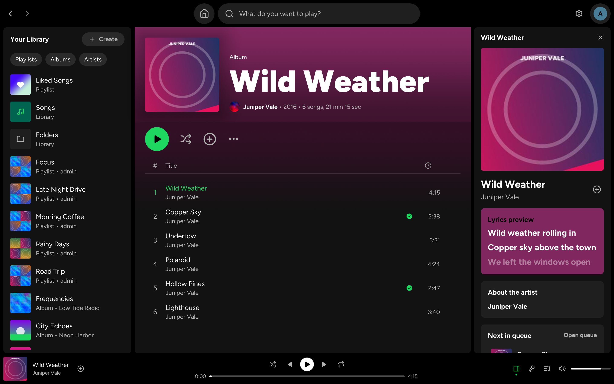

<p align="center">
  
</p>

<h1 align="center">Navify</h1>

<p align="center">
  A desktop music player for Navidrome and OpenSubsonic servers.<br>
  It looks like Spotify. It uses few resources. It runs on Linux, macOS, and Windows.
</p>

<p align="center">
  <a href="https://github.com/pythoncrazy/navify/actions/workflows/ci.yml"></a>
  <a href="https://github.com/pythoncrazy/navify/releases"></a>
  <a href="LICENSE"></a>
</p>

<p align="center">
  
</p>

## Features

- **Playback:** gapless playback, crossfade, ReplayGain (track or album), and fast seek.
  Navify can ask the server to transcode to a different format or a lower bit rate.
- **Library:** albums, artists, songs, playlists, genres, folders, and liked songs.
  Long lists load in pages of 100 as you scroll.
- **Search:** one search box for songs, artists, and albums, with genre tiles to browse.
- **Artists:** popular songs, discography, similar artists, and artist radio.
- **Lyrics:** synced lyrics follow the song. When you scroll, the lyrics stop and a button
  takes you back to the current line. Click a line to go to that time.
- **Queue:** play next, add to queue, shuffle, and repeat. Navify can save the queue on the server.
- **Playlists:** make, rename, change, and delete playlists.
- **Scrobble:** Navify sends plays to the server, which can send them to Last.fm or ListenBrainz.
- **System:** media keys, MPRIS on Linux, the media overlay on Windows, and Now Playing on macOS.
  An optional tray icon keeps Navify open when you close the window.
- **Layout:** drag the edges of the library panel and the right panel to change their width.
- **Resources:** no CPU use when paused, a small memory footprint, and a small binary.
  Covers are kept in a disk cache.

## Keyboard shortcuts

On macOS, use Cmd in place of Ctrl.

| Keys | Action |
| --- | --- |
| Space | Play or pause |
| Ctrl+Left, Ctrl+Right | Previous or next song |
| Shift+Left, Shift+Right | Go back or forward 5 seconds |
| Ctrl+Up, Ctrl+Down | Volume up or down |
| Ctrl+K or Ctrl+L | Search |
| Ctrl+S | Shuffle on or off |
| Ctrl+R | Repeat off, all, or one |
| Alt+Left, Alt+Right | Go back or forward a page |
| Alt+Shift+H | Home |
| Alt+Shift+S | Liked Songs |
| Alt+Shift+J | Now Playing panel |
| Alt+Shift+Q | Queue panel |
| Alt+Shift+L | Collapse or expand the library |
| Alt+Shift+B | Like the current song |
| Ctrl+, | Settings |
| Ctrl+W | Close the window (Navify stays in the tray when the tray is on) |
| Ctrl+Q | Quit |

## Install

Download a file for your system from the
[releases page](https://github.com/pythoncrazy/navify/releases).

| System | File |
| --- | --- |
| Debian, Ubuntu | `navify_<version>_amd64.deb` or `_arm64.deb` |
| Arch Linux | `PKGBUILD-<target>` with `navify_<version>_x86_64.tar.gz` or `_aarch64.tar.gz` |
| Other Linux | `navify_<version>_x86_64.AppImage` or `_aarch64.AppImage` |
| Windows | `navify_<version>_x64-setup.exe` |
| macOS | `Navify_<version>_aarch64.dmg` (Apple silicon) or `_x64.dmg` (Intel) |

`SHA256SUMS` contains the checksums of all files.

### Linux

Install the `.deb` with `sudo apt install ./navify_<version>_amd64.deb`.
For Arch Linux, put the `PKGBUILD-<target>` and the `.tar.gz` in one directory.
Change the name of `PKGBUILD-<target>` to `PKGBUILD`, then run `makepkg -si`.

On other systems, make the AppImage executable with `chmod +x` and start it.
To add the menu entry and the icons to `~/.local/share`, run the AppImage with `--install` one time.

The program needs ALSA and D-Bus. Navify uses Wayland or X11.
On desktops that do not draw title bars for Wayland windows, such as GNOME,
Navify uses X11 to get the system title bar. You can change this in the settings.

The tray icon needs a StatusNotifierItem host. KDE, XFCE, Cinnamon, and waybar have one.
On GNOME, install the AppIndicator extension.

### Windows

Run the setup file. Windows SmartScreen can show a warning because the file has no signature.
Click "More info", then "Run anyway".

### macOS

Open the `.dmg` and move Navify to Applications. The app has no signature.
Before the first start, run this command:

```sh
xattr -dr com.apple.quarantine /Applications/Navify.app
```

## Build

1. Install Rust 1.90 or newer with [rustup](https://rustup.rs).
2. On Linux, install the system libraries and the mold linker:
   `sudo apt-get install libasound2-dev libdbus-1-dev pkg-config mold`
   (Arch Linux: `sudo pacman -S alsa-lib dbus pkgconf mold`).
3. Install sccache. Cargo uses it to keep compiled crates between builds:

   ```sh
   cargo install --locked sccache
   ```

4. Build Navify and install it in `~/.cargo/bin`:

   ```sh
   cargo install --locked --path .
   ```

5. On Linux, run `navify --install` one time to add the menu entry and the icons.

Use `cargo run` for fast development builds, and `cargo run --release` to run the release build.
The release profile uses full LTO and one codegen unit, so a release build takes some minutes.
`.cargo/config.toml` sets sccache, mold on Linux, and the bundled `rust-lld` linker on Windows.
The development profile optimizes the dependencies, so the debug build plays audio at full speed.

To make packages, install cargo-packager and run it after the release build:

```sh
cargo install --locked cargo-packager
cargo packager --release -f deb,pacman -o dist
```

## Development

Install prek to run the git hooks:

```sh
cargo install --locked prek
prek install
```

Run the checks before you commit:

```sh
cargo fmt --all
cargo clippy --workspace --all-targets -- -D warnings
cargo test --workspace
prek run --all-files
```

Some tests use a Navidrome server. They have the `#[ignore]` attribute.
Run them with `cargo test --workspace -- --include-ignored`.
The live tests read `NAVIDROME_HOST`, `NAVIDROME_USERNAME`, and `NAVIDROME_PASSWORD` from `.env`.
The tests that change data read `NAVIFY_TEST_LOCAL_URL`, `NAVIFY_TEST_LOCAL_USERNAME`,
and `NAVIFY_TEST_LOCAL_PASSWORD`. A test fails when a value is missing.

`cargo run --example logo` makes the logo files in `assets/`.

## Release

1. Set the new version in `Cargo.toml`.
2. Push a tag with the same version, for example `v0.2.0`.
3. The release workflow builds all packages and makes a draft release.
4. Examine the draft and publish it.

## AI notice

Claude Opus 5.5, an AI model by Anthropic, wrote this project with human direction and review.

## License

GPL-3.0-or-later. See LICENSE.

Bundled fonts: Figtree under the SIL OFL 1.1 (assets/fonts/OFL.txt),
Lucide under the ISC license (assets/fonts/LUCIDE-LICENSE.txt),
Phosphor under the MIT license (assets/fonts/PHOSPHOR-LICENSE.txt).
